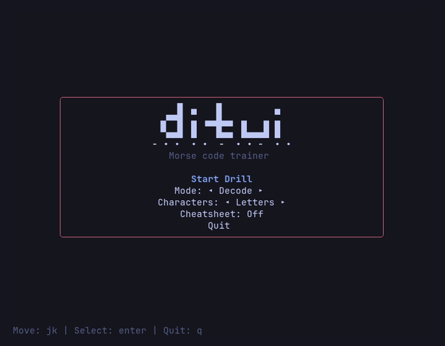

<div align="center">
<pre>
.     ▐▌ ▄   ▐▌         ▄      .
.  ▗▞▀▜▌ ▄ ▗▄▟▙▄▖ ▄   ▄ ▄      .
.  ▝▚▄▟▌ █   ▐▙▄▖ █▄▄▄█ █      .
. − • •  • •  −  • • −  • •    .
<strong>Morse code trainer TUI in Go</strong>
</pre>
</div>

ditui is a TUI trainer for [Morse code](https://en.wikipedia.org/wiki/Morse_code), built with Go and the Bubble Tea TUI framework. It shows you a code to read or a character to key, times each answer, and when you stop it breaks down where you are weakest by character, code length and kind of character.



## Features

- Terminal UI using Bubble Tea and Lip Gloss
- Two directions: decode (read `• − • •`, type `L`) and encode (read `L`, key `.-..`)
- Letters, digits, alphanumeric and punctuation sets, or any characters you pick (`--chars eish5`)
- A live timer per question, a running score and a strip of your recent answers
- Wrong answers show what you actually said, so mix-ups like `R • − •` for `L • − • •` stand out
- An optional cheatsheet with every code of the set under the prompt
- End-of-session results ranking characters, code lengths and kinds worst-first (lowest accuracy, then slowest), with accuracy bars
- A key hints bar at the bottom of the screen
- Configurable colors (see the Themes directory)

## Getting Started

Prerequisites: Go 1.25 or newer (see `go.mod`)

Clone the repository and run locally:

```bash
go run main.go
```

Or build a standalone binary:

```bash
go build -o ditui ./
./ditui
```

Command line flags (each overrides the config file):

- `--mode <decode|encode>` : which way to translate (defaults to `decode`)
- `--set <name>` : `letters`, `digits`, `alphanumeric` or `punctuation` (defaults to `letters`)
- `--chars <characters>` : drill only these characters, overriding `--set`
- `--cheatsheet` : show every code of the set under the prompt
- `--seed <seed>` : ask the same questions every run, as the demo does
- `--version` : print the version and exit
- `--debug` : enable debug logging
- `--debug-file <path>` : write debug logs to the specified file (defaults to `/tmp/ditui.log`)
- `--config <path>` : load the config from `<path>` instead of the default location
- `--no-config` : ignore the config file and run with the built-in defaults

## Configuration

Configuration is read at startup from `$XDG_CONFIG_HOME/ditui/config.yaml`, defaulting to `~/.config/ditui/config.yaml`. The file is optional: anything it leaves out keeps its built-in default (see `internal/config/config.go`), an unparsable file falls back to the defaults entirely, and an invalid mode, set or chars falls back to its own default. An example config with every setting is provided at `Themes/example-config.yaml`.

Configurable items include the mode, the characters drilled, the cheatsheet, and the colors of the UI.

## Controls

Menu:

- `↑`/`↓` or `k`/`j`: Move between items
- `←`/`→` or `h`/`l`: Change the highlighted setting
- `Enter` / `Space`: Select
- `Q`: Quit

Drill, decode:

- Any character: Answer instantly (letters in either case); a character with no code keeps the same question and the clock running
- `Esc`: Finish the session

Drill, encode:

- `.` / `-`: Key a dit or a dah
- `Enter` / `Space`: Answer
- `Backspace`: Drop the last element, `Ctrl-U`: Clear the answer
- `Esc`: Finish the session

Results:

- `←`/`→`, `h`/`l` or `Tab`: Switch between the character, length and kind breakdowns
- `↑`/`↓` or `k`/`j`: Scroll a breakdown too long for the window
- `Enter`: Drill again with the same settings
- `Q` / `Esc`: Back to the menu

`Ctrl-C` quits from anywhere.

## Themes

Theme files are stored in the `Themes` directory; several presets are included (catppuccin-mocha, dracula, gruvbox, rose-pine, tokyo-night). Copy one to `~/.config/ditui/config.yaml`, or merge its `theme` section into your config.

## Development

```bash
make build   # build the binary
make run     # build and run
make test    # run the test suite
make ci      # format check, vet, lint and test
```

Linting and formatting use [golangci-lint](https://golangci-lint.run/welcome/install/); `make demo` regenerates the demo gif with [vhs](https://github.com/charmbracelet/vhs).

## Contributing

Contributions are welcome! Open issues or pull requests for bugs, improvements, or new themes. If you prefer, feel free to fork the project and customize it for your needs.

## License

This project is licensed under the MIT License, see the [LICENSE](LICENSE) file for details.
